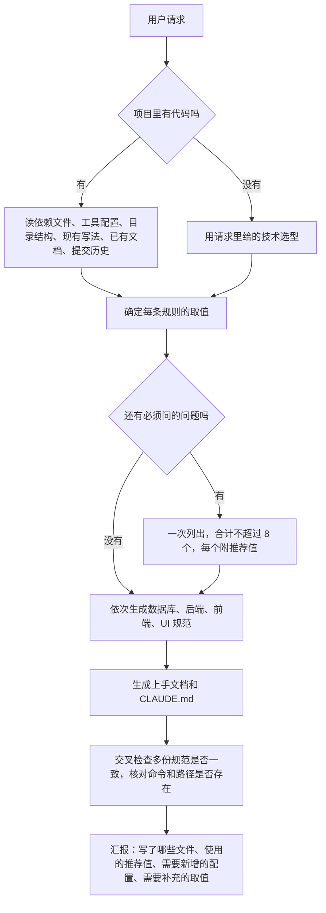

<h2 align="center">project-standards：给项目一键生成开发规范的 Claude Code 插件</h2>

<p align="center">
  <a href="https://github.com/jiangwanyutao/project-standards"></a>
  <a href="https://docs.claude.com/en/docs/claude-code/skills"></a>
  <a href="plugin/.claude-plugin/plugin.json"></a>
  <a href="LICENSE"></a>
  <a href="https://github.com/jiangwanyutao/project-standards/stargazers"></a>
</p>

project-standards 是一个 **Claude Code 插件**：说一句"生成项目规范"，它先**读项目的依赖文件和现有代码**，识别使用的技术和已有写法（空项目就按你给的技术选型），再生成**后端、数据库、前端、UI 规范**，外加给开发者看的**上手文档**和给 AI 看的 **CLAUDE.md**。生成的是基础骨架，团队之后可以在这个基础上逐步补充。

### ✨ 核心特性

- 🔍 **按项目定规则** — 先用对话里你明确说的，再用代码里已经统一的写法，最后才用默认规则，并按目标技术改写（Java/Spring、Go、Python、Node.js；React、Vue；PostgreSQL、MySQL 等）
- 🧩 **一套完整的规范** — 一句话生成 `docs/standards/` 下的后端、数据库、前端、UI 规范和上手文档，以及根目录的 `CLAUDE.md`；也可以只生成其中几份
- 🙋 **少提问** — 只问会明显改变规则的选择和只能由你提供的取值，合计不超过 8 个；其余直接用推荐值，汇报里逐项列出
- 🛡️ **不编造** — 命令、路径、配置文件必须在项目里真实存在，没有的列为"需要新增的配置"，不写成已经在用
- 🔗 **多份规范互相一致** — 生成后交叉检查 JSON 字段大小写、统一响应结构、分页参数、枚举写法和质量门禁命令
- 📝 **不覆盖已有文件** — 目标文件已存在时，先列出新增和冲突的条目，你确认后再合并写入
- 🌓 **主题和响应式默认就有** — Web 前端默认支持浅色、深色、跟随系统三种主题，窄屏下可用；UI 规范给出变量骨架，主题色等取值由团队后续补充

### 最新动态

* **[2026.10]** 🎨 UI 规范改为只生成骨架，主题色等取值写成 `<待补充>` 占位；主题切换、响应式改为默认就有，不再询问（0.3.0）
* **[2026.10]** 🙋 提问收紧到合计不超过 8 个，汇报里新增"使用的推荐值"一节（0.2.0）
* **[2026.10]** 📚 后端、数据库、前端、CLAUDE.md 补充了一批可检查的规则，例如空集合返回 `[]`、PostgreSQL 在线建索引用 `CONCURRENTLY`、React 不用 `useEffect` 同步派生状态（0.2.0）
* **[2026.10]** 🎉 首次发布：7 个 skill，生成后端、数据库、前端、UI 规范、上手文档和 CLAUDE.md

---

## 目录

- [快速开始](#-快速开始)
  - [安装](#安装)
  - [升级](#升级)
  - [使用](#使用)
- [Skill 说明](#%EF%B8%8F-skill-说明)
- [工作原理](#-工作原理)
- [实测数据](#-实测数据)
- [局限性](#%EF%B8%8F-局限性)
- [许可证](#-许可证)

---

## 🚀 快速开始

### 安装

在 Claude Code 里输入：

```text
/plugin marketplace add jiangwanyutao/project-standards
/plugin install project-standards@project-standards
```

也可以在终端里用命令行安装：

```bash
claude plugin marketplace add jiangwanyutao/project-standards
claude plugin install project-standards@project-standards
```

> **环境要求：** [Claude Code](https://docs.claude.com/en/docs/claude-code)。安装后重启 Claude Code，输入 `/project-standards:init-standards` 即可看到。

### 升级

```text
/plugin marketplace update project-standards
/plugin update project-standards
```

然后重启 Claude Code，或在 Claude Code 里输入 `/reload-plugins`。

`/plugin` 界面里 project-standards 的版本号与仓库 [`plugin.json`](plugin/.claude-plugin/plugin.json) 一致，就是最新版。

> 维护者注意：改了 `plugin/` 下的任何内容，都要同时升 `plugin/.claude-plugin/plugin.json` 的 `version`，否则其他人更新时会提示已是最新，拿不到改动。

### 使用

在项目目录里打开 Claude Code，直接说出要生成什么，或者用斜杠命令：

```text
生成项目规范
给这个项目定一套开发规范，后端 Go + Gin + PostgreSQL，没有前端
只生成数据库规范
/project-standards:init-standards
/project-standards:claude-md
```

#### 🗣️ 输出示例

请求：`空项目 fleet-track，纯后端 API 服务。Go 1.22 + Gin + GORM + PostgreSQL 16 + golang-migrate。生成后端规范和数据库规范，再弄个 CLAUDE.md。JSON 字段用 camelCase。别的都用默认，不用问我。`

```text
写了哪些文件
- docs/standards/database.md：数据库设计规范，共 12 章
- docs/standards/backend.md：后端编码规范，共 7 章
- CLAUDE.md：49 行，用 @ 引用两份规范

使用的推荐值
- JSON 字段和查询参数：camelCase（你指定的），分页参数是 page、pageSize
- 统一响应：{code, message, data, detail}，通用错误码 10001 到 10005 和 50000
- 主键：BIGINT GENERATED ALWAYS AS IDENTITY
- 迁移：每个文件设 lock_timeout 和 statement_timeout；CONCURRENTLY 的迁移文件只写一条语句
……

需要你补充的取值
- 业务域和表前缀、部署方式、备份存放目录

需要新增的配置
- go.mod、.golangci.yml、.gitignore、.env.example ……
```

---

## ⚙️ Skill 说明

| Skill | 生成的文件 | 触发说法示例 |
|---|---|---|
| `init-standards` | 下面全部文件，一次识别技术、一次提问，最后做交叉检查 | 生成项目规范、初始化规范、给项目定规矩 |
| `backend-standard` | `docs/standards/backend.md` | 生成后端规范 |
| `database-standard` | `docs/standards/database.md` | 生成数据库规范 |
| `frontend-standard` | `docs/standards/frontend.md` | 生成前端规范 |
| `ui-standard` | `docs/standards/ui.md`（骨架：原则、主题切换、变量名和占位，取值由团队后续补充） | 生成 UI 规范、设计规范 |
| `onboarding-doc` | `docs/standards/README.md`（给开发者看：先读什么、本地环境、开发流程、质量门禁） | 生成上手文档 |
| `claude-md` | 根目录 `CLAUDE.md`（给 AI 看，`@` 引用各规范，不超过 200 行） | 生成 CLAUDE.md |

项目没有前端时跳过前端和 UI 规范，没有数据库时跳过数据库规范。

---

## 📖 工作原理



**每条规则怎么取值**，按下面的优先级：

1. 你在对话里明确说的；
2. 目标项目代码里已经统一使用的写法；
3. 各 skill `references/defaults.md` 里的默认规则，按目标项目的技术改写。

**只问两类问题**：会明显改变规则的选择（例如 JSON 字段用 snake_case 还是 camelCase、界面类型、代码里写法不统一时以哪种为准），以及只能由你提供的取值（项目名、业务域、部署方式和备份位置）。你说了"不用问"时不提问，缺的取值在规范里写占位。

**仓库结构**：

| 路径 | 内容 |
|---|---|
| `.claude-plugin/marketplace.json` | 插件市场清单 |
| `plugin/.claude-plugin/plugin.json` | 插件清单 |
| `plugin/shared/workflow.md` | 所有 skill 共用的步骤：识别技术、提问、取值优先级、已有文件处理、写作要求、写完后的检查 |
| `plugin/skills/<skill>/SKILL.md` | 各 skill 的步骤 |
| `plugin/skills/<skill>/references/` | 默认规则或文档模板 |
| `CHANGELOG.md` | 每个版本的改动 |

---

## 📊 实测数据

<details>
<summary><b>带插件与不带插件的对比（点击展开）</b></summary>

测试方法：3 个空项目，请求里给出技术选型并说明"不用问"，分别在带插件和不带插件的情况下各运行一次，用脚本检查生成的规范（文件是否齐全、章节结构、按技术改写是否正确、多份规范是否一致、问题数等，每个用例 25～29 项）。版本 0.3.0（go 用例为 0.2.0，两版只在 UI 部分有差别，该用例没有前端）。

| 用例 | 技术 | 带插件 | 不带插件 |
|---|---|---|---|
| java-vue-full | Java 17 + Spring Boot 3 + MyBatis-Plus + MySQL 8，Vue 3 + Element Plus | 29/29，0 个问题 | 12/29，19 个问题 |
| go-backend-only | Go 1.22 + Gin + GORM + PostgreSQL 16，无前端 | 25/25，0 个问题 | 13/25，0 个问题 |
| python-react-full | Python 3.12 + FastAPI + PostgreSQL，React 19 + shadcn/ui | 29/29，0 个问题 | 10/29，1 个问题 |

| 指标 | 带插件 | 不带插件 |
|---|---|---|
| 平均通过率 | 100% | 42% |
| 平均用时 | 384 秒 | 251 秒 |
| 平均 token | 134335 | 82051 |

</details>

---

## ⚠️ 局限性

- 模型输出存在波动，同一请求多次运行结果可能略有不同，生成后请过目。
- 空项目生成的规范里，命令和配置文件（如 `pom.xml`、`.golangci.yml`、`package.json` 的 scripts）在项目里还不存在，要按汇报里的"需要新增的配置"建好后才能运行。
- UI 规范只是骨架：主题色、字号、间距、布局尺寸都是 `<待补充>`，需要团队自己补充。
- 默认规则按"后台管理"类 Web 项目整理，面向用户的站点和移动端只会改写布局一章，其他细节需要团队补充。
- 带插件生成比不带插件多用约一半的时间和 token，主要花在逐个生成和最后的交叉检查上。
- 只适用于 Claude Code。

---

## 📄 许可证

本项目基于 [MIT](LICENSE) 协议发布。

## ⭐ Star 历史

[](https://star-history.com/#jiangwanyutao/project-standards&Date)
